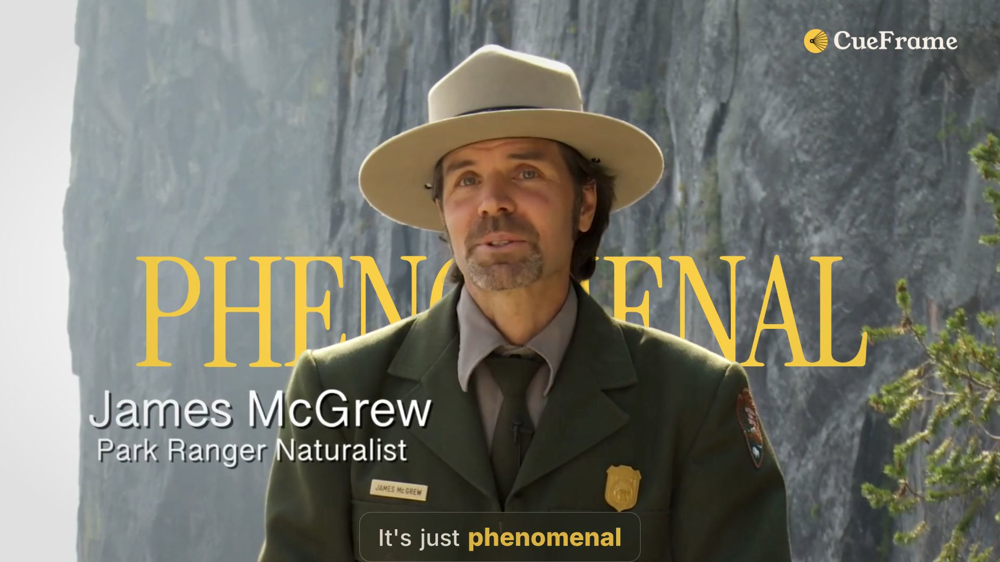
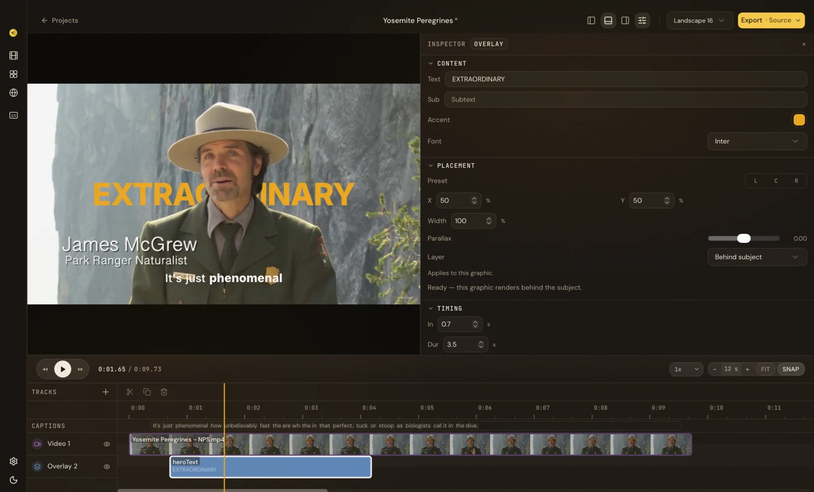
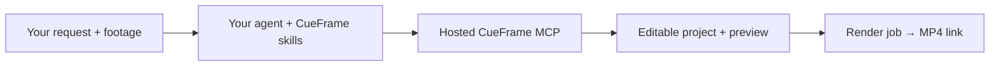

# CueFrame — MCP, CLI and video API

[](https://api.cueframe.ai/v1/mcp) [](skills/) [](LICENSE) [](https://docs.cueframe.ai)

CueFrame is a hosted service for composing, editing and rendering video. Connect your agent over MCP, automate an edit from the CLI, or integrate the REST API into your application. Each surface works with editable projects containing clips, captions and motion graphics, and renders them to MP4.

| Your workflow | Start here |
| --- | --- |
| Ask an agent to make or edit a video | [MCP and agent plugin](#mcp-and-agent-plugin) |
| Run video workflows from a terminal or script | [CLI](#cli) |
| Build video editing into an application | [API and TypeScript SDK](#api-and-typescript-sdk) |

[First render](https://cueframe.ai/start) · [Connection guide](https://docs.cueframe.ai/docs/setup) · [Templates](https://cueframe.ai/templates) · [API reference](https://docs.cueframe.ai/docs/api) · [Agent documentation index](llms.txt)

[](https://cueframe.ai/start)

*A frame from the Yosemite Peregrines template. [Watch the video and try the same edit](https://cueframe.ai/start).*

## MCP and agent plugin

For Claude Code, Codex, Cursor, VS Code, and other supported local agents, run this in your terminal with **Node.js 24 or newer**:

```bash
npx -y cueframe@0.11 install
```

The installer detects supported agents and adds the hosted CueFrame MCP endpoint to their configuration. It installs the skills in `~/.agents/skills` and `~/.claude/skills`, preserving locally modified skills by default. It can update multiple detected clients; use `--dry-run` to inspect the changes first.

Restart your agent session. Then ask:

> Use CueFrame's get_account tool to check my connection and show my available credits.

Your client may prompt you to authenticate or open a browser. Sign in to CueFrame and authorize the connection; interactive OAuth clients need no API key. Cloud operations use credits. Check your balance and estimated costs before starting paid work; see [cloud rates](https://cueframe.ai/pricing).

**ChatGPT and Claude Desktop:** use your client's hosted connector setup with `https://api.cueframe.ai/v1/mcp`, then authenticate. The terminal installer does not configure ChatGPT. See the [connection guide](https://docs.cueframe.ai/docs/setup) and [CueFrame connection skill](skills/cueframe-connect/SKILL.md) for supported paths. Skills installation and hosted connector setup are separate steps.

**Already connected?** Skip installation and give your agent a video task. If CueFrame's tools do not appear, restart the client and check its MCP connection settings.

## Make your first video

Try the [Yosemite first-render walkthrough](https://cueframe.ai/start): render a template, change one word, and render again from the same project.

1. Download the **full original footage** from the [National Park Service](https://www.nps.gov/media/video/view.htm?id=53135a56-4998-4d6e-b26d-24fe0acca1c3) as `yosemite-peregrines.mp4`. Use the original source, because the finished demo has its title baked in. Follow the source's download and reuse guidance.
2. Give your connected agent the source file and this instruction:

   > Use CueFrame to start the yosemite-peregrines template from cueframe-ai/cueframe-templates with this original video. Load template.cueframe and its prepared subject matte. Preview the editable project and estimate cloud costs. After I approve the render, return the MP4 link and project ID.

3. After the first render, ask:

   > In that same project, replace the behind-subject title PHENOMENAL with EXTRAORDINARY. Preserve the footage, spoken captions, audio, timing, placement, and depth. Preview the changed title, estimate the render cost, and render after I approve.

The template selects 83.616–93.359 seconds of the original video. You should get two MP4s from one editable project. Uploading footage and running cloud operations use credits; the two renders are billed separately.

[](https://cueframe.ai/start)

*The project stays editable: the desktop editor shows the title as a separate layer, alongside footage and captions. [Watch the title change](https://cueframe.ai/start).*

### What happens over MCP?



The agent inspects available tools, checks your account, prepares media and the project, previews changes, and submits a render. Long-running operations return IDs; the agent waits for completion and gives you the result. You do not need to write the tool calls yourself. The [detailed quickstart](https://docs.cueframe.ai/docs/quickstart) explains the individual calls.

For your next video, describe the result and provide the inputs:

> Turn this interview into a 20-second vertical clip with word-timed captions. Preview the strongest moment and show estimated costs before rendering.

> Find an image-carousel component for these product photos. Show suitable choices and their required inputs before creating the video.

> Change only the final title in this project. Keep the rest of the edit unchanged.

## Other installation options

Choose one setup path. A plugin installs the skills and hosted MCP configuration together. A server-only connection adds tools; skills provide the workflow guidance.

<details>
<summary><strong>Claude Code and Codex plugins</strong></summary>

Claude Code:

```bash
claude plugin marketplace add cueframe-ai/cueframe-mcp
claude plugin install cueframe@cueframe
```

Codex:

```bash
codex plugin marketplace add cueframe-ai/cueframe-mcp
codex plugin add cueframe@cueframe
```

Restart the session, authenticate when prompted, and ask the agent to call `get_account`.

</details>

<details>
<summary><strong>Gemini CLI and Agent Skills clients</strong></summary>

Gemini CLI:

```bash
gemini extensions install https://github.com/cueframe-ai/cueframe-mcp
```

Install skills in any client that supports Agent Skills:

```bash
npx skills add cueframe-ai/cueframe-mcp
```

Skills alone do not connect the MCP server. Add the hosted endpoint through your client's MCP settings if it is not already connected.

</details>

<details>
<summary><strong>MCP server only, manual setup, and headless clients</strong></summary>

The hosted endpoint is **`https://api.cueframe.ai/v1/mcp`**, using Streamable HTTP. For example, in Claude Code:

```bash
claude mcp add --transport http cueframe https://api.cueframe.ai/v1/mcp
```

For Cursor and VS Code, use the one-click links in the [connection guide](https://docs.cueframe.ai/docs/setup). Configuration keys differ between clients. Per-client examples are in [`examples/`](./examples).

Interactive clients can use browser sign-in. Headless clients send `Authorization: Bearer cf_live_…`; see [llms-install.md](./llms-install.md) for authentication and stdio bridge options. The `glama/` shim executes no tools and cannot be used to make videos.

</details>

## Skills included

Skills teach the agent how to carry out video tasks. You describe the task; the agent selects the relevant guidance.

| Task | Skills |
| --- | --- |
| Plan and compose a new video | [cueframe-storyboard](skills/cueframe-storyboard/SKILL.md), [composing-video](skills/composing-video/SKILL.md) |
| Clip a podcast or interview | [clip-a-talking-head](skills/clip-a-talking-head/SKILL.md) |
| Make a launch film or social reel | [launch-video](skills/launch-video/SKILL.md), [make-a-social-reel](skills/make-a-social-reel/SKILL.md) |
| Make a brand reel or change an existing brand | [brand-reel](skills/brand-reel/SKILL.md), [rebrand-a-video](skills/rebrand-a-video/SKILL.md) |
| Extract a visual style | [extracting-brand-kits](skills/extracting-brand-kits/SKILL.md) |
| Create a product demo | [cueframe-brand-demo](skills/cueframe-brand-demo/SKILL.md), [cueframe-product-video](skills/cueframe-product-video/SKILL.md) |
| Customize motion graphics or make a 3D shot | [cueframe-component-authoring](skills/cueframe-component-authoring/SKILL.md), [cueframe-scene-shot](skills/cueframe-scene-shot/SKILL.md) |
| Add music or adapt to more formats | [add-music-bed](skills/add-music-bed/SKILL.md), [every-format-from-one-edit](skills/every-format-from-one-edit/SKILL.md) |
| Preview, refine, and check quality | [cueframe-compose-loop](skills/cueframe-compose-loop/SKILL.md), [video-craft-standards](skills/video-craft-standards/SKILL.md) |
| Connect or work through the CLI | [cueframe-connect](skills/cueframe-connect/SKILL.md), [cueframe-cli](skills/cueframe-cli/SKILL.md) |

Claude Code's session hook and Cursor's rule help select the entry point. Other hosts load the installed skills through their own mechanisms. Scoped edits should preserve unrelated work.

## CLI

Use the CLI for explicit video commands, shell scripts and structured JSON output. It connects to the hosted API; it does not run a local renderer. Requires **Node.js 24 or newer**.

```bash
npx -y cueframe@0.11 --help
npx -y cueframe@0.11 login
npx -y cueframe@0.11 api GET /v1/me --json
npx -y cueframe@0.11 describe --json
```

`login` opens the browser to authenticate. Headless scripts can supply `CUEFRAME_API_KEY`. The account request checks your connection and credits; `describe` lists command arguments and options without making an API call.

[CLI guide](packages/cli/README.md) · [CLI walkthrough](https://cueframe.ai/cli) · [Templates](https://cueframe.ai/templates) · [npm package](https://www.npmjs.com/package/cueframe)

## API and TypeScript SDK

Use the REST API to create projects, import media, change compositions and follow render jobs from your application. Requests go to **`https://api.cueframe.ai`** with an API key from [your account](https://app.cueframe.ai). Check your account before metered operations; cloud rendering and processing use credits.

For TypeScript or JavaScript on **Node.js 24+**, install the typed client:

```bash
npm install @cueframe/sdk
```

```js
import { account, createClient } from "@cueframe/sdk";

if (!process.env.CUEFRAME_API_KEY) throw new Error("Set CUEFRAME_API_KEY");
createClient({
  baseUrl: "https://api.cueframe.ai",
  apiKey: process.env.CUEFRAME_API_KEY,
});
const result = await account.getAccount();
console.log(result.plan, result.entitlements);
```

Other languages can call REST directly or generate a client from the versioned [public OpenAPI contract](packages/api-contract). The SDK is a client for the hosted service, not the server implementation.

[API walkthrough](https://cueframe.ai/api) · [API reference](https://docs.cueframe.ai/docs/api) · [SDK guide](packages/sdk/README.md) · [Render example](examples/render-a-clip) · [npm package](https://www.npmjs.com/package/@cueframe/sdk)

## What this repository contains

This repository contains the **agent plugin**, **developer toolkit**, and **registry files**. The hosted MCP server is maintained separately in the application repository. You connect to CueFrame's hosted service; cloning this repository does not run that service locally.

| Area | What you can use or contribute |
| --- | --- |
| [`skills/`](skills), host manifests, [`hooks/`](hooks), [`rules/`](rules) | Agent workflows, plugin installation, and task routing |
| [`packages/`](packages) | The public API contract, TypeScript SDK, CLI, and packaged skills |
| [`examples/`](examples), [`llms-install.md`](llms-install.md) | Client setup and an end-to-end SDK render example |
| [`server.json`](server.json), [`glama/`](glama) | Hosted-server registration and a discovery-only shim |
| [`tools/`](tools), [`scripts/`](scripts) | Generators, validation, packaging, and repository checks |

## Contribute

Documentation, client examples, skill improvements, and toolkit fixes are welcome. Start with [good first issues](https://github.com/cueframe-ai/cueframe-mcp/labels/good%20first%20issue) or read [CONTRIBUTING.md](CONTRIBUTING.md) for setup, generated-file rules, tests, and commit sign-off.

Edit skills in root `skills/`; change generated API clients through their documented inputs. Report hosted-service problems in this repository's issue tracker with reproduction steps and a request ID when available. Report vulnerabilities privately using [SECURITY.md](SECURITY.md). Community participation follows the [Code of Conduct](CODE_OF_CONDUCT.md).

## Published packages

| Package | Purpose | npm |
| --- | --- | --- |
| [`@cueframe/api-contract`](./packages/api-contract) | The public OpenAPI document, its reviewed operation inventory and a content-addressed manifest: the only input the generated clients read. | [](https://www.npmjs.com/package/@cueframe/api-contract) |
| [`@cueframe/sdk`](./packages/sdk) | Typed fetch-based TypeScript client with zod request schemas and SSE helpers for render and compose progress. | [](https://www.npmjs.com/package/@cueframe/sdk) |
| [`cueframe`](./packages/cli) | The CLI: login, projects, media, compositions, renders, exports and `install`, every command with `--json`. | [](https://www.npmjs.com/package/cueframe) |
| [`@cueframe/skills`](./packages/skills) | The `skills/` tree as an npm package (`SKILLS_DIR` from `@cueframe/skills/dir`), for programs that copy or embed the skills. | [](https://www.npmjs.com/package/@cueframe/skills) |

The MCP server itself (`@cueframe/mcp`) is a private package maintained in the application repository; this repository ships the contract it is generated from, the clients, the plugin, the registry entry (`server.json`) and a discovery shim, not the server.

### How the contract flows

```
private API ──sync──▶ api/openapi.json (+ scene-schema.json, scene-examples.json, contract-manifest.json)
                          │
                          ├──▶ packages/api-contract/dist  ──publish──▶  @cueframe/api-contract@x.y.z ──▶ the MCP server's generators, third parties
                          └──▶ packages/sdk/src/generated        (Orval: operations, models, zod)
```

The private API publishes its OpenAPI projection into `api/`; `pnpm generate:api-consumers` regenerates the SDK from it. This is the one copy of the contract: the MCP server's generators in the application repository and every other consumer read it from the `@cueframe/api-contract` npm package, whose version moves with the contract (`pnpm check:contract-version` fails an `api/*.json` change without a bump), so the tool surface and the SDK always describe one contract. Nothing under `api/` or a `generated/` directory is hand-edited: `pnpm check:api-inputs` proves the three `api/*.json` inputs came from one sync, and `pnpm check:api-consumer-drift` proves the generated trees match them byte for byte.

### How the skills flow

Root `skills/` is the single source: the plugin hosts read it from this repository, and `pnpm build` copies it into `packages/skills/dist` (published as `@cueframe/skills`) and from there into the CLI's `dist/skills` for `cueframe install`. `pnpm check:plugin` validates every skill and manifest; `agents/openai.yaml` and `assets/icon.svg` beside each skill are generated.

## Registry files

- [`server.json`](./server.json): the MCP registry entry for the hosted server (`ai.cueframe/cueframe`, remotes only). `pnpm check:server-json` validates it against the vendored registry schema; the `registry` job of the publish workflow publishes it.
- [`glama.json`](./glama.json): the Glama listing's maintainer file.
- [`glama/`](./glama) and the [`Dockerfile`](./Dockerfile): a stdio discovery shim that replays a snapshot of the hosted server's tool list and instructions for registries that introspect over stdio. It is not a server (see below).

## Hosted, desktop-local, and the discovery shim

The hosted service, desktop integration, and registry shim serve different purposes.

- **The hosted server** at `https://api.cueframe.ai/v1/mcp` is the product. Every install line above talks to it; it authenticates with OAuth or an API key and does the composing and rendering. Its package, `@cueframe/mcp`, is private.
- **The CueFrame desktop app ships its own local MCP server** for the project you have open. It needs no account and is connected through the connection file the app publishes; the app's Agents settings show the exact command, and https://docs.cueframe.ai explains it. Its bundled binary is called `cueframe-mcp`; it lives inside the app bundle.
- **This repository's discovery shim** ([`glama/server.mjs`](./glama/server.mjs), built by the [`Dockerfile`](./Dockerfile)) is not a server. It replays a snapshot of the hosted server's tool list and instructions over stdio so registries that build an image can list the tools without an account; every `tools/call` answers with a pointer to the hosted server. [`glama/refresh-snapshot.md`](./glama/refresh-snapshot.md) says where the snapshot comes from.

## Repository layout

- `skills/<name>/SKILL.md`: the skill. `agents/openai.yaml` and `assets/icon.svg` beside it are generated (`pnpm build:plugin`).
- `.claude-plugin/`, `hooks/`, `.mcp.json`: Claude Code plugin, session router and server.
- `.codex-plugin/`, `.agents/plugins/`, `mcp.json`: Codex and ChatGPT plugin and marketplace.
- `.cursor-plugin/`, `rules/`: Cursor plugin and the always-on rule.
- `gemini-extension.json`, `skills.sh.json`, `plugin.json`: Gemini CLI, skills.sh, the portable manifest (agent-plugins.org).
- `api/`, `packages/`, `tools/`, `scripts/`: the contract, the four npm packages, their generators and checks (`scripts/plugin/` holds the plugin's).
- `server.json`, `glama.json`, `glama/`, `Dockerfile`: the registry files.
- `catalog/`: the tool reference and error codes exported from the MCP catalog in cueframe-ai/cueframe (`pnpm --filter @cueframe/mcp export:tool-reference -- <this repository>/catalog` there). `skills/cueframe-connect/references/tools.md` is rendered from it, and the skills check reads it: a skill may name only a tool it lists.
- `examples/`, `llms-install.md`: per-client setup and the agent-readable install guide.

## Development

```
pnpm install
pnpm check      # input provenance, the contract version rule, the public-contract gate, server.json, the plugin, and tsc --noEmit in sdk and cli
pnpm build      # stamps the plugin manifests and skill cards, then tsup in every package; the CLI packages the skills
pnpm test
```

Node 24 or newer and pnpm (see `.nvmrc` and `packageManager`). [CONTRIBUTING.md](./CONTRIBUTING.md) explains which paths are generated, the skill contract and how a change travels; [AGENTS.md](./AGENTS.md) is the same for an agent working in this tree; [llms-install.md](./llms-install.md) connects a client step by step.

## License

Apache-2.0. See [LICENSE](./LICENSE) and [NOTICE](./NOTICE).
