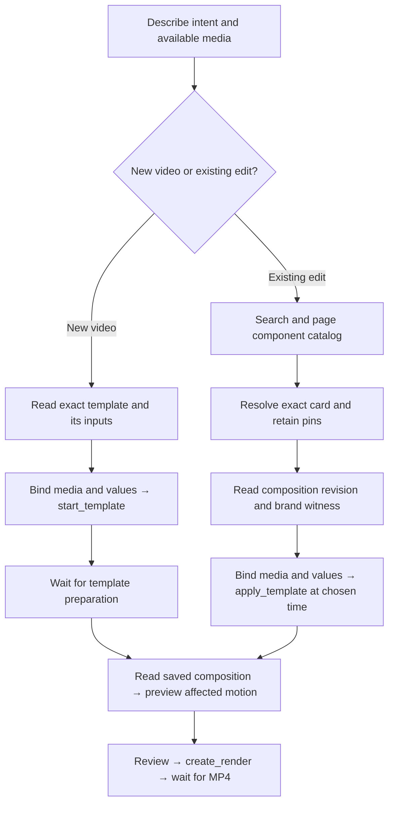

# Start a template or insert a component?

Start a **complete-video template** when you want a new video with its own project, timeline, media slots and editable values. The [Yosemite walkthrough](../README.md#make-your-first-video) is an example. Insert a **component package** when you already have a composition and want to add a reusable piece, such as a rotating photo layout, at a chosen time. The insertion keeps existing clips and the package's authored placement offsets.

These are hosted MCP workflows through `https://api.cueframe.ai/v1/mcp`. The `glama/` snapshot documents the tools; its discovery shim cannot execute them. Check `get_account` and current cost estimates before metered preparation, previews or rendering.



## Starting a complete video

Use `list_templates({limit:20})` for your organization's saved templates, following `pagination.nextCursor` with `after`. Public catalog slugs are not listed there: use a known public reference from the [template catalog](https://cueframe.ai/templates), or follow the public walkthrough's file-based instructions. A component card's ID is not a public template slug.

The following is an annotated tool sequence, not a script to run unchanged. Uppercase variables mean values you obtained from the selected template, your media or a previous response:

```js
get_template({template: TEMPLATE_REF});
// Read declared media slots, value parameters, presets and track outline.
// Use full:true if you need the complete document.

start_template({
  template: TEMPLATE_REF,
  projectName: "My first video",
  values: TEMPLATE_VALUES,
  media: TEMPLATE_MEDIA,
  commandId: "start-video-1"
});
wait_job({kind: "template", id: RETURNED_JOB_ID});
// Continue with the returned project and composition, then preview/render below.
```

`start_template` takes its fields at the top level. Bind every required slot by its declared name: for example, a slot's value can be `{mediaId:"your-imported-media-id"}`, `{url:"https://example.com/your-video.mp4",mimeType:"video/mp4"}`, or `{sample:true}` when the selected template provides that sample. These are binding shapes, not guaranteed media assets. Use parameter names and allowed values from `get_template`; do not guess them. Preparation may import media or prepare mattes before returning a ready project.

## Inserting a reusable component

1. Search from the user's intent, then inspect actual cards:

   ```js
   list_catalog({
     projection: "component-library", origin: "builtin",
     q: "image carousel", limit: 10
   });
   ```

   **Observed search limitation:** searches for `image carousel`, `video carousel`, and `rotating gallery` returned no built-in components, while searching by the known component name `wheel` found a suitable example. This records the reported observation; this guide does not claim a fresh live search retest. Intent queries do not always find a match.

   If empty, omit `q` to inspect the available catalog, page with `after: pagination.nextCursor`, and consider supported filters such as `category:"layouts"` or `libraryKind:"recipe"`. Inspect descriptions, media requirements and intended use before choosing; the known-name query `q:"wheel"` is an example, not a general fallback for every request. `origin:"library"` selects the authenticated organization's library instead; keep scopes distinct.

2. Select a preset or recipe card and resolve its **exact** identity:

   ```js
   resolve_builtin_component({
     collection: SELECTED_COLLECTION,
     id: SELECTED_BUILTIN_ID,
     revision: SELECTED_CARD_REVISION
   });
   ```

   Retain the card's scope, collection, ID and revision, and the resolved `documentSha256`, canonical document and member source pins. A definition card is source material, not a complete insertable package. Do not replace a selected revision with the latest, switch scope, invent wrapper source or reconstruct the package from its thumbnail. The public [Wheel request fixture](../skills/cueframe-compose-loop/references/builtin-requests.json) shows a historical exact selection; obtain current identities from your own selected card.

3. Read the existing target before writing:

   ```js
   get_composition({
     projectId: PROJECT_ID,
     componentExecutionVersions: ["3", "4"],
     includeDependencies: "true"
   });
   ```

   Keep the observed numeric revision, exact `expectedBrandIdentity` and composition identity. An ETag is a separate witness; do not substitute it for the numeric `expectedRevision`. Compact reads retain structural data and pins; use `response:"full"` when you need complete dependency tokens or sources.

4. Inspect the resolved document's media slots, values, duration and placements. Bind every required slot explicitly. For the reviewed Wheel fixture, the eight image slots are `image1` through `image8`. Each accepts `{mediaId:"your-imported-image-id"}` or an explicit `{sample:true}` for its pinned sample; samples are never chosen implicitly. An HTTPS URL binding is also supported. Check the selected document for the current slot list and media kinds; a rotating image layout does not imply support for video.

   ```js
   apply_template({
     template: SELECTED_BUILTIN_ID,
     body: {
       projectId: PROJECT_ID,
       documentSha256: RESOLVED_DOCUMENT_SHA256,
       insert: {startTime: 3, idPrefix: "wheel-insertion-1"},
       expectedRevision: OBSERVED_REVISION,
       commandId: "insert-wheel-1",
       componentExecutionVersions: [3, 4],
       expectedBrandIdentity: OBSERVED_BRAND_IDENTITY,
       values: {},
       media: {
         image1: {sample: true}, image2: {sample: true},
         image3: {sample: true}, image4: {sample: true},
         image5: {sample: true}, image6: {sample: true},
         image7: {sample: true}, image8: {sample: true}
       }
     }
   });
   ```

   This example chooses Wheel's pinned samples; replace bindings with your imported media IDs as needed and supply declared parameter values. `startTime` is nonnegative seconds; `idPrefix` must be unique in the target. The insertion's fields live inside `body`, including its `commandId`. Read negotiation uses strings `["3","4"]`; insertion negotiation uses numbers `[3,4]`.

   Stale revision, source pin or brand failures require a reread and reconciliation with concurrent changes. Do not silently refresh witnesses to force the old edit through. If preparation returns a pending response, retain the same command and `commandId` and follow its retry delay, as described in the [canonical insertion workflow](../skills/cueframe-compose-loop/references/builtin-insertion.md).

## Preview and deliver either result

Read `get_composition` again. For insertion, check that existing clips remain, package placements have the intended offsets, and exact source pins survived. Use the returned composition ID consistently. Choose a motion window covering the affected animation and its boundaries, at most 60 seconds:

```js
preview_clip({
  projectId: PROJECT_ID,
  body: {compositionId: COMPOSITION_ID, fromSec: WINDOW_START, toSec: WINDOW_END}
});
wait_job({kind: "render", id: PREVIEW_RENDER_ID, projectId: PROJECT_ID});
// Inspect the returned preview's motion, placement and any affected audio.

create_render({
  projectId: PROJECT_ID,
  body: {compositionId: COMPOSITION_ID, intent: "final"}
});
wait_job({kind: "render", id: FINAL_RENDER_ID, projectId: PROJECT_ID});
```

Reuse returned job IDs while waiting. `preview_clip` produces a **render** job, even though it is a preview. Submit the final render after review and any required cost approval; inspect the MP4 before delivering its link and project ID. Preview evidence and a completed export are separate results.

## Schema evidence

Request shapes were reviewed against the public hosted MCP 0.13.1 tool list (96 tools, captured October 28, 2026), reproduced in [`glama/tools.json`](../glama/tools.json). Consult your connected server's current schemas when executing. The examples above use observed-value variables rather than reusable revision/hash witnesses; schema validation alone cannot establish that a media ID, pin or revision exists.

Canonical references: [builtin insertion workflow](../skills/cueframe-compose-loop/references/builtin-insertion.md), [public request fixture](../skills/cueframe-compose-loop/references/builtin-requests.json), [preview workflow](../skills/cueframe-compose-loop/references/preview-workflow.md), and [composition guidance](../skills/composing-video/SKILL.md). The sequence can be reviewed locally without credentials or paid calls; no render or live search was run to write this guide.
